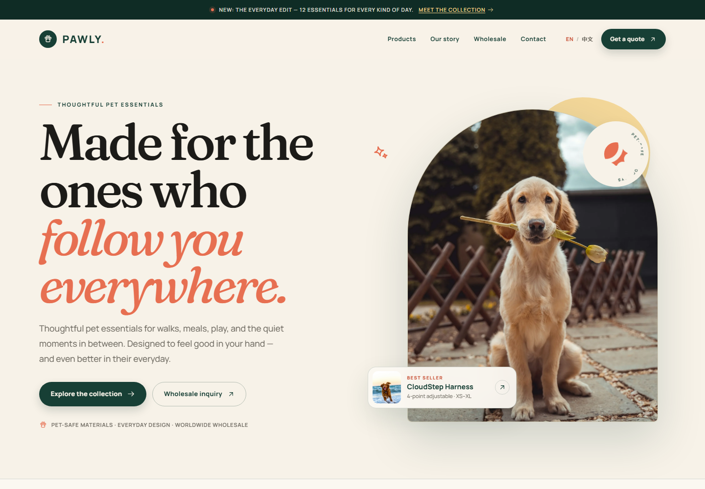

# PAWLY — 宠物用品跨境品牌官网

一个中英双语、静态生成的宠物用品品牌展示站，面向海外宠物主与 B 端采购商。重点展示产品系列、品牌故事与 OEM/ODM 批发能力，并通过询盘表单完成转化。

- **视觉方向**：Warm Editorial / Natural Premium
- **技术栈**：Astro 5 + TypeScript + 原生 CSS，无 UI 框架
- **输出**：纯静态 `dist/`，可部署到 Netlify、Vercel、Cloudflare Pages 等
- **页面数量**：38 个静态页面（中英双语、12 个产品详情、404、隐私条款）
- **表单**：前端校验 + `mailto:` 询盘，后续可替换为 Formspree / Netlify Forms / 自建接口

> 当前品牌名、联系方式、产品参数、MOQ、认证与图片均为演示内容。正式上线前请按下方“上线前替换清单”替换为真实信息。

---

## 预览



更多预览：[批发页](docs/preview-wholesale.png) · [移动端首页](docs/preview-mobile.png)

---

## 快速开始

要求 Node.js 20+（已在 Node 22 验证），推荐使用 pnpm。

```bash
pnpm install
pnpm dev
```

本地开发地址：`http://localhost:4321`

生产构建与预览：

```bash
pnpm build
pnpm preview
```

其他检查：

```bash
pnpm check       # Astro / TypeScript 检查
pnpm check:site  # 检查构建产物中的内部链接、图片、SEO 标签
```

`pnpm-workspace.yaml` 中的 `allowBuilds` 用于允许 pnpm 11 执行 `esbuild` 与 `sharp` 的安装脚本，请保留该文件。

完整部署方案见 **[DEPLOYMENT.md](DEPLOYMENT.md)**，包括：

- Windows / macOS / Linux 本地运行
- Ubuntu + Nginx 静态部署
- 域名、HTTPS、防火墙
- Docker / docker-compose 部署
- 更新、回滚、日志与故障排查
- GitHub Actions 自动部署

如果使用 GitHub Pages，请看 **[GITHUB_PAGES.md](GITHUB_PAGES.md)**：项目站点、自定义域名、用户站点、DNS、CNAME 与排错。

---

## 目录结构

```text
.
├─ public/
│  ├─ images/                 # 本地 WebP 图片
│  └─ favicon.svg
├─ src/
│  ├─ components/
│  │  ├─ Header.astro
│  │  ├─ Footer.astro
│  │  ├─ ProductCard.astro
│  │  ├─ InquiryForm.astro
│  │  └─ ...
│  ├─ data/
│  │  ├─ site.ts              # 品牌、联系方式、语言路径
│  │  └─ products.ts          # 分类与 12 个产品
│  ├─ i18n/
│  │  └─ ui.ts                # 全部中英文 UI 与页面文案
│  ├─ layouts/
│  │  └─ BaseLayout.astro     # SEO、hreflang、字体、Header/Footer
│  ├─ pages/
│  │  ├─ index.astro          # 英文首页
│  │  ├─ products/            # 英文产品列表与详情
│  │  ├─ about.astro
│  │  ├─ wholesale.astro
│  │  ├─ contact.astro
│  │  ├─ legal.astro
│  │  ├─ 404.astro
│  │  ├─ robots.txt.ts        # 按 site/base 自动生成 sitemap 声明
│  │  └─ zh/                  # 中文镜像路由
│  ├─ styles/
│  │  └─ global.css           # 设计系统与全部页面样式
│  └─ views/                  # 中英文共用的页面模板
├─ astro.config.mjs
├─ package.json
└─ pnpm-workspace.yaml
```

---

## 修改指南

### 1. 品牌名、Logo 与联系方式

- 品牌名、域名、邮箱、WhatsApp、地址、社交账号：`src/data/site.ts`
- Logo 文字当前在 `src/components/Logo.astro` 中写为 `PAWLY.`，替换品牌名时请同步修改。
- 首页/页脚中的品牌介绍文案：`src/i18n/ui.ts` 的 `footer.intro`。

### 2. 全站文案

所有页面文案集中在 `src/i18n/ui.ts`，按 `en` / `zh` 两组组织。产品名称、描述、参数在 `src/data/products.ts`。

修改时可对照两组 key，确保中英文同时更新。`pnpm check` 会检查 Astro / TypeScript 错误，但不会自动检查所有文案是否语义一致。

### 3. 产品与分类

- 产品：`src/data/products.ts` 的 `products` 数组。
- 分类：同文件的 `categories` 数组。
- 新增产品后，`/products/[slug]` 与 `/zh/products/[slug]` 会自动生成对应页面。
- 每个产品包含：名称、卖点、描述、适用对象、Features、Specs、养护、MOQ、配色、3 张图片、是否首页推荐。
- 产品详情页通过 `product.images` 生成图集，建议保持 3 张图片。

### 4. 图片

图片统一放在 `public/images/`，建议：

| 用途 | 建议比例 | 建议尺寸 |
|---|---|---|
| 首页 Hero | 4:5 | 1600 × 2000 |
| 产品卡 / 分类卡 | 4:5 | 900 × 1125 |
| 品牌故事 / 场景图 | 4:3 | 1200 × 900 |
| 批发 / 联系页 | 4:3 | 1200 × 900 |
| OG 分享图 | 1.91:1 | 1200 × 630 |

当前演示图来自 Unsplash（Unsplash License），已下载到本地并转为 WebP。正式上线建议替换为自有产品实拍图。若继续使用图库图，请按 Unsplash License 核对使用范围并保留来源记录。

### 5. 配色与字体

编辑 `src/styles/global.css` 顶部的 CSS 变量：

```css
--forest: #173f35;
--cream: #f7f2e8;
--coral: #e76f51;
--sage-light: #dfe9e1;
--oat: #e8dcc7;
```

英文字体使用本地打包的 Fraunces + Manrope；中文使用系统苹方 / 思源黑体 / 微软雅黑回退，避免额外中文字体体积。

### 6. 语言切换与持久化

- 英文默认路径：`/`
- 中文路径：`/zh/`
- 切换语言时保持当前页面。
- 用户主动切换后，选择会写入 `localStorage` 的 `pawly-lang`；下次访问首页时自动进入对应语言。
- 首次访问不会强制跳转。
- 如需取消持久化，删除 `src/layouts/BaseLayout.astro` 中的 `pawly-lang` 相关脚本即可。

### 7. 询盘表单

当前表单行为：

1. 前端校验必填项、邮箱与隐私同意；
2. 校验通过后，用 `mailto:` 打开本机邮件客户端；
3. 自动带入姓名、公司、邮箱、国家、咨询类型、产品与留言。

正式上线建议接入真实表单服务。两种常见方式：

**Formspree**

1. 在 `InquiryForm.astro` 的表单上增加 `action="https://formspree.io/f/你的表单ID" method="POST"`；
2. 删除当前 `form.addEventListener('submit', ...)` 中的 `event.preventDefault()` 和 `window.location.href = mailto`；
3. 保留前端校验，提交后由 Formspree 处理并转发邮件。

**Netlify Forms**

1. 表单增加 `data-netlify="true"` 和隐藏字段 `form-name`；
2. 删除当前 `mailto:` 提交逻辑；
3. 部署到 Netlify 后在后台配置通知邮箱。

产品详情页的 “Inquire about this product” 会跳转到批发页并自动选中对应产品；联系页的 “Request a sample” 同理。

### 8. SEO 与部署

- 站点域名：`astro.config.mjs` 的 `site` 字段。
- `robots.txt` 由 `src/pages/robots.txt.ts` 自动生成，Sitemap 地址跟随 `site` + `base`。
- 页面 title / description：`src/i18n/ui.ts` 的 `meta`。
- `BaseLayout.astro` 已生成 canonical、`hreflang="en"`、`hreflang="zh-CN"`、`x-default`、OG、Twitter Card 和 Organization / Product JSON-LD。
- 构建产物为 `dist/`，可直接部署为静态站点。
- 构建命令：`pnpm build`；输出目录：`dist`。
- 静态路由不需要 SPA rewrite；`404.html` 会被主流静态托管识别。

### 9. 上线前替换清单

- [ ] 品牌名、Logo、域名、邮箱、WhatsApp、地址、社交账号
- [ ] 产品名称、描述、规格、真实图片、真实 MOQ
- [ ] 认证、客户评价、合作品牌、数据类表述（当前为示例或已避免虚构）
- [ ] 隐私政策与条款，交由法律顾问审阅
- [ ] 表单接收方式（Formspree / Netlify / 自建接口）
- [ ] `site` 域名与自动生成的 `robots.txt` Sitemap
- [ ] 真实 OG 分享图
- [ ] 若接入统计或广告 Cookie，补充对应的同意管理

---

## 范围说明

首期包含：品牌展示、产品分类/搜索、产品详情、品牌故事、批发合作、联系与询盘、中英双语、SEO。

首期不包含：购物车、在线支付、会员、订单、库存、CMS 后台。后续可接 Shopify Buy Button、Stripe、Snipcart 或 Headless CMS。

---

## 技术说明

- Astro 静态生成，默认几乎零客户端 JS；交互仅包含菜单、筛选、搜索、图集切换、表单校验和滚动揭示。
- 所有图片本地化，避免外链失效；使用 WebP 与懒加载。
- 响应式适配 360 / 390 / 768 / 1024 / 1440，已通过桌面与移动端溢出检查。
- 支持 `prefers-reduced-motion`，并包含键盘焦点、跳转主内容、表单错误提示与 ARIA 标签。
